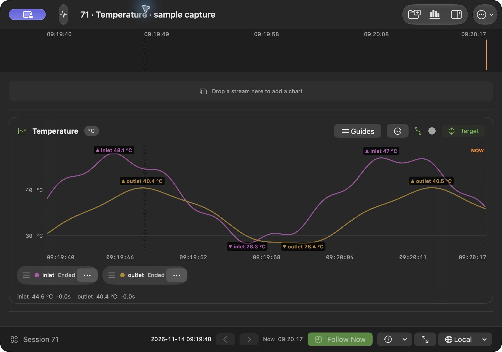

# PipePlot

PipePlot is a macOS utility that plots numbers from standard input over time.
Each whitespace-separated column becomes a line. Rows are timestamped when
received, and captures are saved locally.

For example, track the resident memory of your current shell once a second:

```sh
pp --watch "ps -p $$ -o rss=" --interval 1 -c -n rss -u KiB
```

Replace `$$` with another process ID to track that process. Press Ctrl-C to
stop capture; the data remains saved. Pan, zoom and select a time range in the
app while new samples continue to arrive.



## Examples

Generate two test signals:

```sh
pp --test 2 -c
```

Plot the one-minute load average on macOS:

```sh
pp --watch 'sysctl -n vm.loadavg | awk "{print \$2}"' \
  --interval 1 -c -n load
```

See [runnable examples](docs/USAGE.md#runnable-examples-macos) for process
memory, ping times and transfer rates with `pv`. Run `pp --help` for options.

## Install

With [Homebrew](https://brew.sh/):

```sh
brew install --cask alchemyst/tap/pipe-plot
```

The Homebrew command is `pipeplot-pp`; use it wherever the examples say `pp`.
Open PipePlot from Applications before the first capture. The same
unnotarized-preview notice below applies to Homebrew installations.

### Download the disk image

[Download PipePlot 0.2.0 preview](https://github.com/alchemyst/pipe-plot/releases/download/v0.2.0/PipePlot-0.2.0-macos-arm64-adhoc.dmg) for **Apple Silicon, macOS 27 or later**.
[Release notes and checksum](https://github.com/alchemyst/pipe-plot/releases/tag/v0.2.0).

**Unnotarized preview:** this build is ad-hoc signed, without Developer ID
signing or Apple notarization. macOS may block its first launch. See
[Apple's instructions](https://support.apple.com/en-us/102445) if you choose to open it.

1. Open the DMG and drag **PipePlot.app** to **Applications**.
2. Open the installed app and choose **PipePlot → Install pp Command…**.
3. If Terminal cannot find `pp`, add the following to `~/.zprofile`, then open
   a new Terminal window:

```sh
export PATH="$HOME/.local/bin:$PATH"
```

## Build from source

Requires Xcode with the macOS 27 SDK, [just](https://just.systems/), POV-Ray,
and Python 3 with Pillow.

```sh
git clone https://github.com/alchemyst/pipe-plot.git
cd pipe-plot
just install
```

This installs `~/Applications/PipePlot.app` and `~/.local/bin/pp`. See the
[development guide](docs/DEVELOPMENT.md) for toolchain and build details.

## Documentation

- [Project website](https://alchemyst.github.io/pipe-plot/) — runnable examples.
- [Usage](docs/USAGE.md) — commands, chart controls, selections and CSV export.
- [Development](docs/DEVELOPMENT.md) · [Contributing](CONTRIBUTING.md).
- [Validation and known limits](docs/VALIDATION.md).
- [Releases](https://github.com/alchemyst/pipe-plot/releases) · [Issues](https://github.com/alchemyst/pipe-plot/issues).

## Related tools and inspiration

[pv](https://www.ivarch.com/programs/pv.shtml) reports progress through a pipe.
[ttyplot](https://github.com/tenox7/ttyplot) plots stdin in a terminal;
[wesplot](https://github.com/cactusdynamics/wesplot) plots it in a browser.
Their pipeline workflows and examples are inspiration for PipePlot, which
uses a native macOS window and keeps a local capture history.
See [similar projects](docs/SIMILAR_PROJECTS.md) for other tools.

## License

[MIT](LICENSE) © Carl Sandrock.
